<p align="center">
  
</p>

# clearcam: Add object detection, tracking, mobile notifications, AI summaries, and search to any security camera.

> ### ⚡ Featured: KineLab Motion 2.0 (`apps/kinelab-motion`)
> **Real-Time Single-Camera Motion Intelligence, 3D Biomechanics & Synchronized Video Replay Studio**  
> 33-Landmark Pose Tracking • Kinematic Bone-Length Invariance Filter • Decoupled 60/120 FPS Interpolation • Depth Audio Ping & Web Speech Voice Coach • Segment Angles (Shank & Trunk) • Dual Video + Telemetry Replay  
> 🚀 **Quick Start:** `python apps/kinelab-motion/serve.py 4173` → [http://localhost:4173](http://localhost:4173)  
> 📖 **Read the Documentation:** [KineLab Motion 2.0 Studio Guide](apps/kinelab-motion/README.md) • [193 Passing Automated Tests](apps/kinelab-motion/README.md#13-testing-known-limitations-and-verification-status)

<table align="center" cellspacing="0" cellpadding="0" style="border-collapse: collapse;">
<tr valign="top">
<td style="padding-right: 10px;">
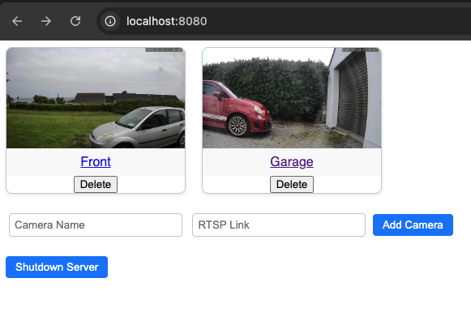<br/>
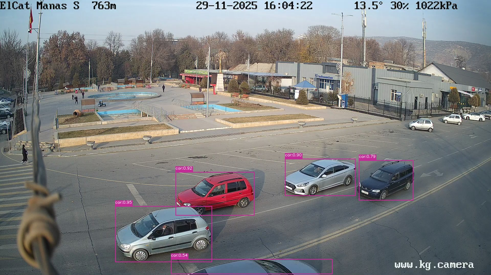
</td>
<td>
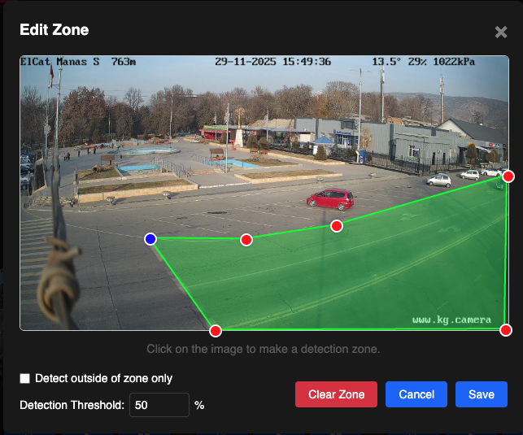
</td>
</tr>

<tr>
  <td colspan="2" align="center">
    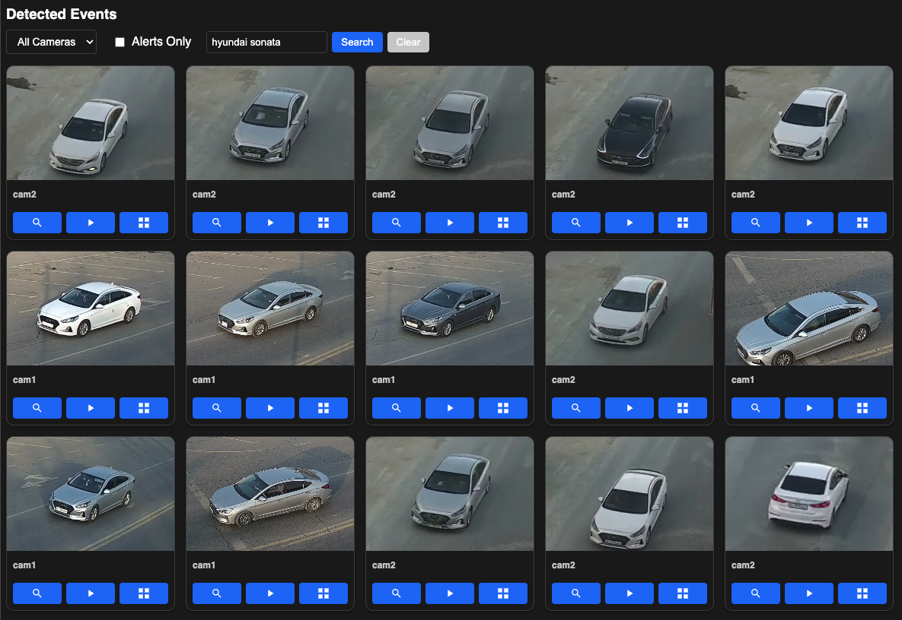
  </td>
</tr>
<tr>
  <td colspan="2" align="center" style="padding: 20px 0;">
    <div style="margin-bottom: 8px; font-weight: bold;">
      *NEW* AI Notification Summaries with Qwen3 VL
    </div>
    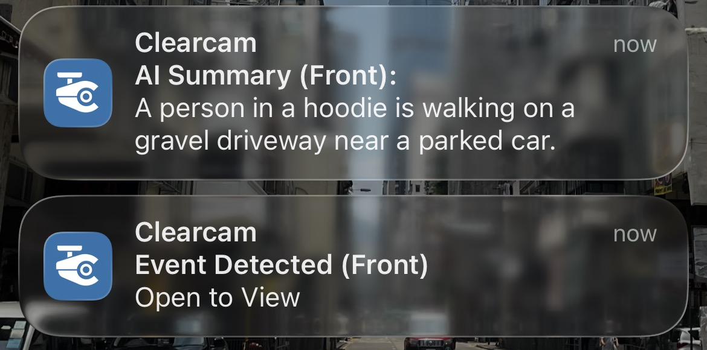
  </td>
</tr>
<tr>
  <td colspan="2" align="center">
    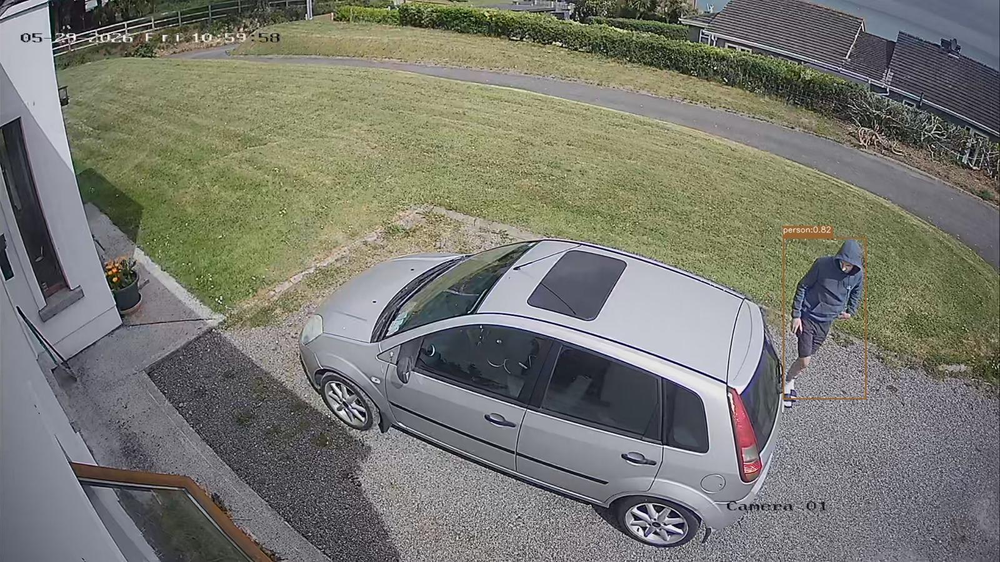
  </td>
</tr>

<tr>
<td>
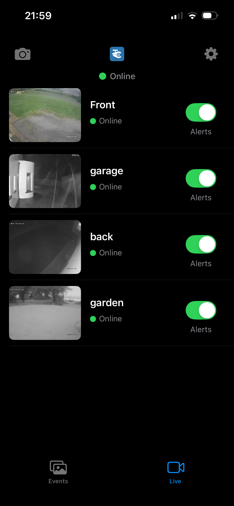
</td>
<td>
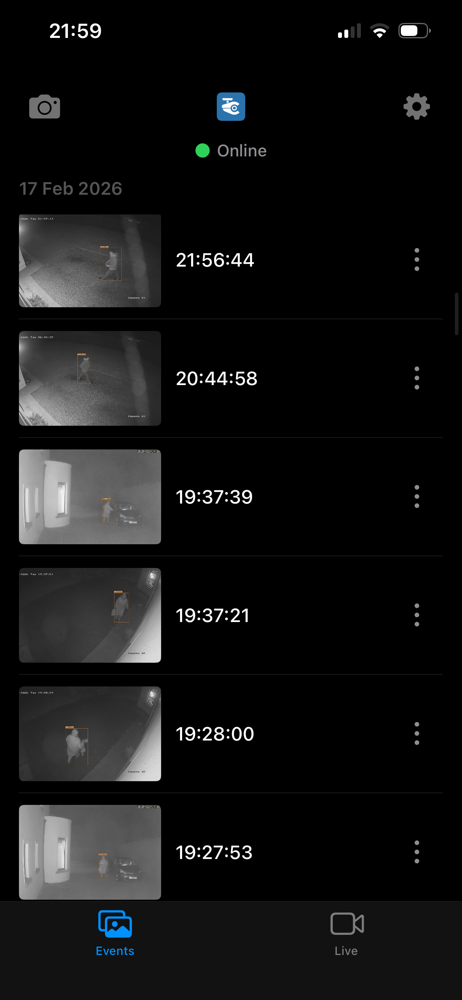
</td>
</tr>

<tr>
  <td align="center">
    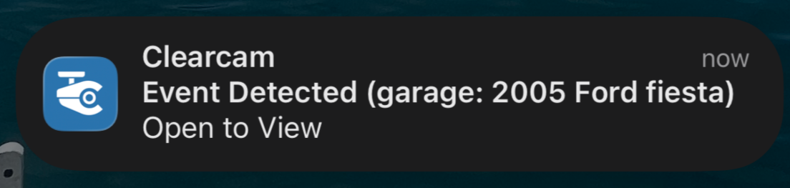
  </td>
  <td align="center">
    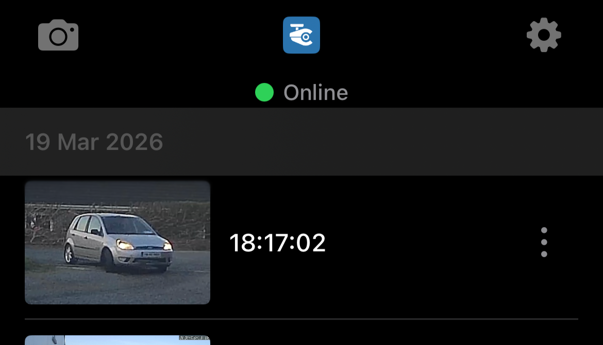
  </td>
</tr>
<tr>
  <td align="center">
    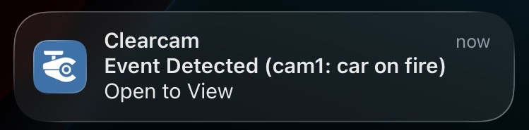
  </td>
  <td align="center">
    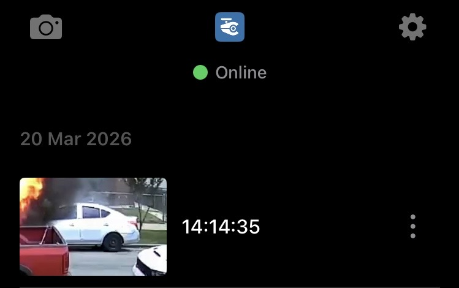
  </td>
</tr>
</table>

---

## ⚡ KineLab Motion 2.0 — Motion Intelligence Studio (`apps/kinelab-motion`)

KineLab Motion 2.0 is an interactive, single-camera real-time motion analysis and biomechanics platform integrated directly into the Clearcam project.

- **33-Landmark Pose Tracking**: Powered by Google MediaPipe Tasks Vision (`@mediapipe/tasks-vision@1.2.3`), defaulting to the Heavy model with automatic Full fallback.
- **3D Metric Vector Kinematics**: Computes 3D joint angles and sagittal trunk tilt from pelvis-centered metric coordinates in meters ($X, Y, Z$), perspective-invariant to camera angle or depth foreshortening.
- **Smart Body Framing Assistant**: Real-time on-canvas positioning radar and limb guidance, with upper-body decoupling for seated or close-up exercise tracking.
- **One Euro Temporal Smoothing**: Eliminates joint jitter at rest while preserving instantaneous response during explosive movements.
- **Modular Exercise Recognition**: State-machine repetition counting, hold timers, and form feedback for Squats, Sit-to-Stand, Lunges, Shoulder Abduction, Shoulder Flexion, and Single-Leg Balance.
- **Synchronized Video + Skeleton Replay**: High-performance IndexedDB video recording paired with animated skeletal telemetry replay, frame scrubbing, and playback speed control.
- **Privacy by Design**: 100% browser sandbox execution. Zero video frames or biomechanical telemetry uploaded to external servers.

### Run KineLab Motion:
```bash
python apps/kinelab-motion/serve.py 4173
```
Open [http://localhost:4173](http://localhost:4173) in Google Chrome, Microsoft Edge, or Safari.

### Run Tests:
```bash
node --test apps/kinelab-motion/tests/*.test.mjs
```
*74 automated unit, integration, and kinematics benchmark tests on Node.js 20+ with zero npm dependencies.*

For complete module architecture maps and settings references, see [KineLab Motion Documentation](apps/kinelab-motion/README.md).

---

### Don't own an RTSP camera yet?
Try it out with this feed: https://webcam.elcat.kg/Too-Ashu_Tunnel_North/index.m3u8 (https://kg.camera)

## (old) video demo:
https://x.com/RoryClear/status/1959249250811785405

## computer requirements
- Mac, Linux, ~~Windows~~ *ffmpeg fix needed
- ffmpeg
- python3.11 or later

## run NVR + inference in python from source
1. pip install -r requirements.txt
2. python3 clearcam.py
3. open localhost:8080 in your browser
4. (optional) enter your Clearcam premium userID in the web UI settings (viewable in iOS app settings page) to receive notifications and clips in the Clearcam iOS and Android app.
- use DEV=AMD / DEV=NV python3 clearcam.py if your CPU is being used instead of your GPU
- use BEAM=2 python3 clearcam.py for extra performance (wait time on first run)

## Add notifications via your browser (**New**) (Beta)
1. Open settings in Clearcam
2. Press Generate Vapid key and copy the generated key
3. Using the device you would like to receive notifications on, open https://roryclear.github.io/selfnotify/subscribe.html, copy the generated Vapid key, and press generate
    - if using an iOS device, you must add the homepage to your home screen to generate the keys.json file
4. Copy the downloaded keys.json file into Clearcam/notify_keys on your computer

## Bring your own notifications!
- You can now change the URL notifications are sent to in settings.
- Use Home Assistant, Pushover, N8N, or any program to send yourself alerts.
- Sample Pushover notification server included: https://github.com/roryclear/clearcam/blob/main/utils/sample_server.py

## install iOS App from source
1. git clone https://github.com/roryclear/clearcam.git
2. open ios/clearcam.xcodeproj

## iOS requirements
- iOS 15 or newer
- iPhone SE (1st gen) or newer (older iPhones *might* work)
- dependencies: NONE!

<table border="0" cellspacing="0" cellpadding="0">
  <tr>
    <td align="center">
      <a href="https://apps.apple.com/gb/app/clearcam/id6743237694">
        
      </a>
    </td>
    <td align="center">
      <a href="https://play.google.com/store/apps/details?id=com.rors.clearcam">
        
      </a>
    </td>
  </tr>
</table>

</br>
<table>
  <tr>
    <td>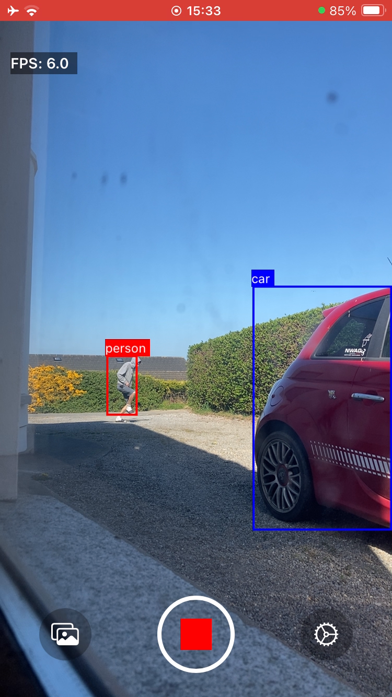</td>
    <td>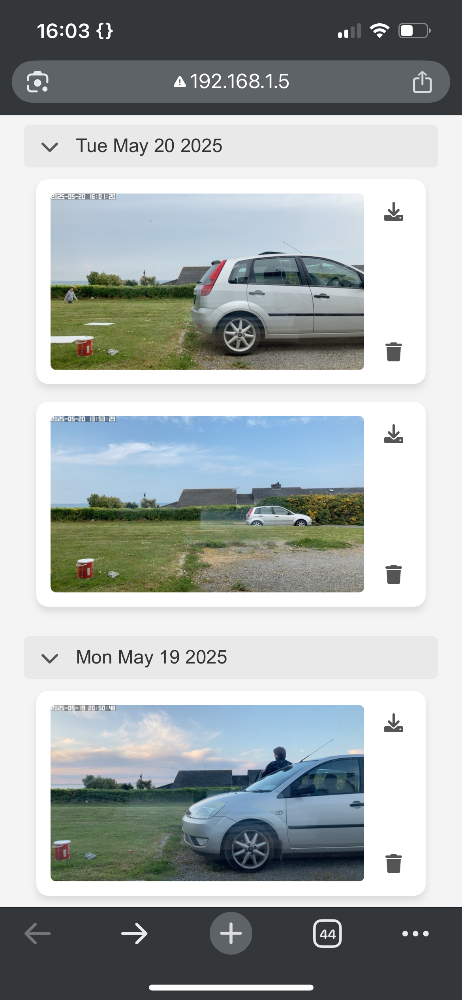</td>
  </tr>
</table>
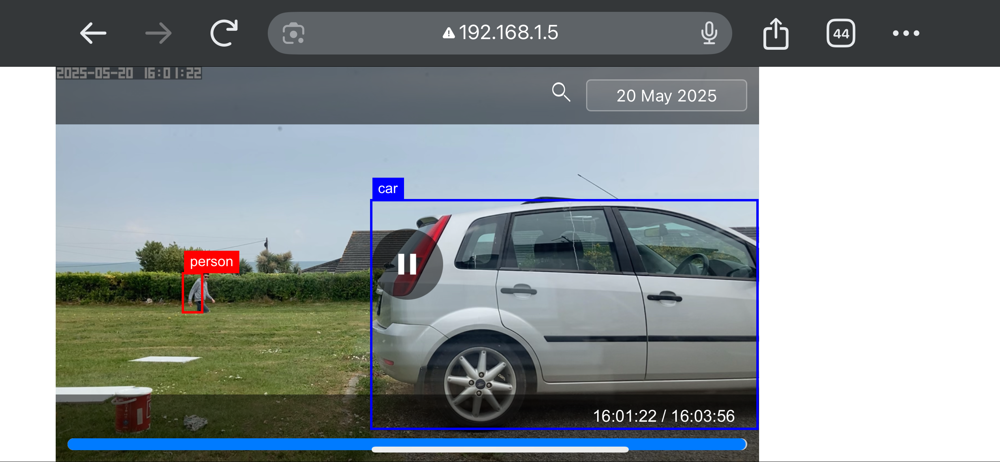

# Signing Up for Clearcam Premium

## Features
- View your live camera feeds remotely.
- Receive notifications on events (objects/people detected).
- View event clips remotely.
- End-to-end encryption on all data.

## How to Sign Up

Visit [clearcam.org](https://www.clearcam.org) to sign up, or upgrade to premium in the iOS app.
